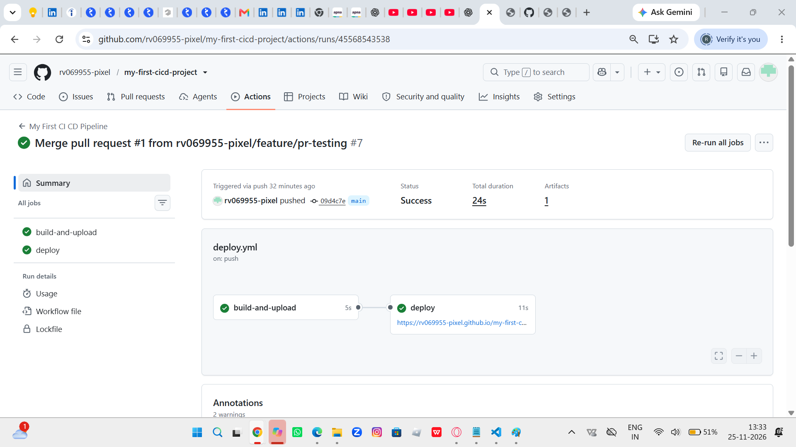

## 📸 Project Screenshots

### 1. Live Website

### 2. Successful GitHub Actions Pipeline

### 3. Merged Pull Request

## 🏗️ CI/CD Architecture

Developer → Git → GitHub → GitHub Actions
→ CI Validation → Artifact Upload
→ GitHub Pages → Live Website

## 🚀 Deployment Process

- Code changes are pushed to GitHub.
- Pull Requests trigger CI validation.
- Merged changes trigger the deployment workflow.
- GitHub Actions uploads the website artifact.
- GitHub Pages deploys the website automatically.